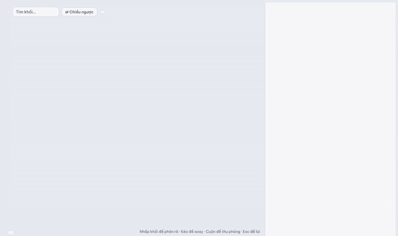

# Giải phẫu mạng nơ-ron · Neural Network Anatomy

Explore seven neural network architectures in 3D, block by block, from the whole model down to a single matrix multiply.
Khám phá bảy kiến trúc mạng nơ-ron trong 3D, mở từng khối từ toàn bộ mô hình xuống tới từng phép nhân ma trận.



**Live demo:** https://firstkhoi.github.io/visualize-dl/

[English](#english) · [Tiếng Việt](#tiếng-việt)

---

## English

The interface and explanations are in Vietnamese. Every block in every model can be opened and shows:

- its **tensor shapes** (batch dimension dropped), drawn to scale: a thick box has weights or changes shape, a thin slab keeps the shape;
- the **formula**, a **worked example with real numbers**, and the **parameter count**, computed in code;
- **PyTorch code** for the block and the **paper** it comes from, with the section;
- the other models where the same idea appears ("Cũng xuất hiện ở").

### Models

| Model | What you see | Runs in the page |
|---|---|---|
| **Transformer** (Vaswani et al., 2017, base) | Encoder–decoder, post-LN, sinusoidal PE, cross-attention | Self-attention on a toy sentence, with causal mask and √dₖ scaling toggles |
| **LLaMA 3 8B** | Decoder-only, RMSNorm, RoPE, grouped-query attention, SwiGLU, KV cache, sampling | Masked self-attention on the same toy sentence |
| **ViT-B/16** | Patch embedding, [CLS] token, learned positions, pre-LN encoder | – |
| **ResNet-50** | Stem, bottleneck blocks, BatchNorm, projection shortcuts | Editable 8×8 convolution; gradient through up to 100 layers with and without shortcuts |
| **LSTM** (Zaremba et al., 2014) | Gates, cell state, unrolled time steps | Gradient through time: plain RNN vs. the LSTM cell path |
| **U-Net** (Ronneberger et al., 2015) | Contracting and expanding paths, copy & crop | Unpadded 8×8 convolution |
| **Training lab** | A 2 → H → H → 2 MLP with hand-written backprop | Trains live: SGD / Momentum / Adam, ReLU / tanh, 4 datasets, decision boundary, loss curve, advice read from the curve, real weight matrices painted on the 3D blocks |

The attention and convolution demos use small hand-picked inputs so every number can be read. Only the training lab learns its weights.

### Also

- Search any block with **Ctrl F**. Press **Esc** to go up a level.
- **Chiều ngược** (backward) makes the particles flow from the loss to the input, like gradients.
- Every view has its own link, e.g. `#llm.2.1`.
- Works in light and dark mode, and on phones and tablets.

### Run it

Open `index.html` in a browser. There is no build step. Three.js, MathJax and the fonts load from CDNs, so you need to be online.

```sh
npm test            # unit tests: Node 22+, nothing to install
npm ci && npx playwright install chromium    # once, for the browser tests
npm run test:e2e    # the page itself in headless Chromium, offline
./build-pages.sh    # rebuilds docs/ (the GitHub Pages copy); commit docs/ with your change
```

The tests run every script of the page in Node. That covers the self-checks inside the scripts (toy attention against values computed in Python, the toy convolution, backprop against finite differences, the parameter totals of LLaMA 3, ViT, ResNet-50, LSTM, U-Net and the lab's MLP), plus the training lab's optimizers, pacing and advice. The browser tests open the page with three.js from `node_modules` and check what you see: the decision boundary on the 3D block, a run stopping when you leave the lab, theme switches, the loss chart and its tooltip, and that screen readers aren't flooded during training. CI runs both on every push and fails if `docs/` is out of date.

### Files

```
index.html        page, 3D scene, panel, lab UI
blocks.js         shared blocks (attention, FFN, norms…), paper list, concept index
live.js           what really computes: toy attention, toy conv, gradient experiments, the trainable MLP
models/*.js       one file per architecture
tests/            node --test suites (tests/e2e: in the browser)
docs/             copy for GitHub Pages, built by build-pages.sh
```

To add a model, create `models/<name>.js` (see `models/vit.js` for a short one) and add its `<script>` tag to `index.html`. The tests pick it up automatically.

### Roadmap

1. Demos for missing ideas: sampling temperature and top-p, overfitting in the lab, normalisation axes, ViT patches, receptive fields, RoPE, BPE.
2. Real trained models in the browser: a small CNN on MNIST where you draw a digit, and a tiny Vietnamese GPT trained on *Truyện Kiều*.
3. New architectures built from existing blocks: diffusion, CLIP, mixture of experts, VAE.
4. English content.

---

## Tiếng Việt

Mỗi khối trong mỗi mạng đều mở được và cho thấy:

- **shape của tensor** (bỏ chiều batch), vẽ theo tỉ lệ: khối dày là có trọng số hoặc đổi shape, lát mỏng là giữ nguyên shape;
- **công thức**, **ví dụ với số thật**, **số tham số** (tính bằng code);
- **code PyTorch** và **paper gốc**, kèm mục trong paper;
- những mạng khác có cùng ý tưởng ("Cũng xuất hiện ở").

### Các mạng

| Mạng | Nội dung | Chạy thật trong trang |
|---|---|---|
| **Transformer** (2017, base) | Encoder–decoder, Post-LN, PE hình sin, cross-attention | Self-attention trên câu đồ chơi, bật/tắt mặt nạ nhân quả và chia √dₖ |
| **LLaMA 3 8B** | Chỉ decoder, RMSNorm, RoPE, GQA, SwiGLU, KV cache, lấy mẫu | Attention có mặt nạ trên cùng câu đồ chơi |
| **ViT-B/16** | Patch embedding, token [CLS], vị trí học được, encoder Pre-LN | – |
| **ResNet-50** | Stem, khối bottleneck, BatchNorm, đường tắt chiếu | Tích chập 8×8 sửa được; gradient qua tối đa 100 lớp, có và không có đường tắt |
| **LSTM** (2014) | Các cổng, bộ nhớ c, trải theo thời gian | Gradient đi ngược theo thời gian: RNN thường so với đường c của LSTM |
| **U-Net** (2015) | Nhánh co và nhánh giãn, cắt và nối | Tích chập 8×8 không đệm |
| **Huấn luyện** | MLP 2 → H → H → 2, backprop viết tay | Train ngay trong trang: SGD / Momentum / Adam, ReLU / tanh, 4 bộ dữ liệu, ranh giới quyết định, đường loss, lời khuyên đọc từ đường loss, ma trận trọng số thật tô lên khối 3D |

Demo attention và tích chập dùng đầu vào nhỏ chọn tay để đọc được từng con số. Chỉ phòng thí nghiệm huấn luyện là học trọng số thật.

### Chạy

Mở `index.html` bằng trình duyệt, không cần build. Three.js, MathJax và font tải từ CDN nên cần có mạng.

```sh
npm test            # unit test: Node 22 trở lên, không cần cài gì
npm ci && npx playwright install chromium    # một lần, cho test trình duyệt
npm run test:e2e    # chạy chính trang web trong Chromium headless, không cần mạng
./build-pages.sh    # build lại docs/ (bản cho GitHub Pages); commit docs/ cùng thay đổi
```

Test chạy mọi script của trang trong Node. Chúng kiểm tra các self-check có sẵn trong script (attention đồ chơi so với giá trị tính bằng Python, tích chập đồ chơi, backprop so với sai phân hữu hạn, tổng số tham số của LLaMA 3, ViT, ResNet-50, LSTM, U-Net và MLP của phòng thí nghiệm), cùng các bộ tối ưu, nhịp train và lời khuyên của phòng thí nghiệm. Test trình duyệt mở trang với three.js lấy từ `node_modules` và kiểm tra những gì người dùng thấy: ranh giới quyết định trên khối 3D, việc train dừng khi rời phòng thí nghiệm, đổi theme, đồ thị loss và tooltip, và trình đọc màn hình không bị đọc dồn dập khi đang train. CI chạy cả hai mỗi lần push và báo lỗi nếu `docs/` chưa được build lại.

Muốn thêm một mạng: tạo `models/<tên>.js` (xem `models/vit.js` là file ngắn), rồi thêm thẻ `<script>` vào `index.html`. Test sẽ tự nhận file mới.

---

Inspired by [TensorFlow Playground](https://playground.tensorflow.org/). Built with [three.js](https://threejs.org/) and [MathJax](https://www.mathjax.org/).
License: [MIT](LICENSE).
